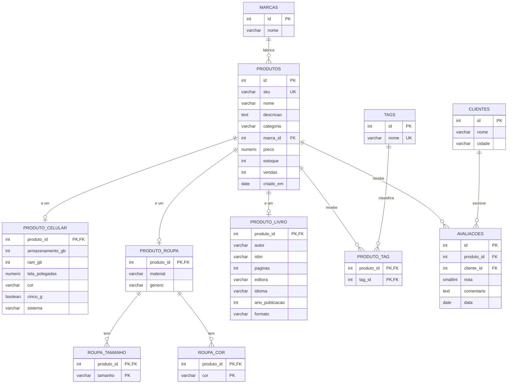

# Comparativo com o modelo relacional (PostgreSQL)

Os mesmos 36 produtos foram modelados no PostgreSQL. A carga SQL é gerada a partir do mesmo
`dados/produtos.json` (`python scripts/gera_sql.py`), então os dois bancos têm exatamente os mesmos dados.

Para subir o PostgreSQL e rodar as consultas:

```bash
docker compose --profile sql up -d postgres
docker exec -it busca-postgres psql -U loja -d loja -f /sql/03_consultas.sql
```

## Diagrama ER



São **11 tabelas** no relacional contra **1 índice** no Elasticsearch. A criação completa está em
[`sql/01_schema.sql`](../sql/01_schema.sql). Atributos que só alguns produtos têm (como `resistenciaAgua`,
`protecaoUV` ou `serie`) não cabem nesse esquema sem um `ALTER TABLE` ou uma coluna JSONB.

## Duas consultas reescritas em SQL

Arquivo completo: [`sql/03_consultas.sql`](../sql/03_consultas.sql). Resultados abaixo foram obtidos rodando no PostgreSQL 16.

### C2 — tolerância a erro de digitação ("samsumg galxy")

```sql
SELECT p.sku, p.nome, p.preco,
       round(similarity(unaccent(lower(p.nome)), 'samsumg galxy')::numeric, 3) AS similaridade
FROM produtos p
WHERE similarity(unaccent(lower(p.nome)), 'samsumg galxy') > 0.25
ORDER BY similaridade DESC
LIMIT 5;
```

```
   sku   |           nome           |  preco  | similaridade
---------+--------------------------+---------+-------------
 CEL-001 | Samsung Galaxy S24 128GB | 3999.00 |        0.310
 CEL-002 | Samsung Galaxy A55 256GB | 2199.00 |        0.300
 CEL-009 | Samsung Galaxy A15 128GB |  899.00 |        0.300
```

Funciona, mas: precisa de **duas extensões** (`pg_trgm` e `unaccent`); o limite `0.25` foi escolhido na tentativa e erro,
e não serve para todo caso — buscando `iphnoe` (letras trocadas) o iPhone tem similaridade de só **0,12** e não aparece,
enquanto no Elasticsearch a troca de duas letras vizinhas conta como **1 edição** e o iPhone é encontrado. Além disso,
compara o **nome inteiro** com a frase, e não palavra por palavra, e só olha **um campo** — para buscar também em marca,
descrição e tags seria preciso juntar tudo e perder os pesos.

### C4 — filtros + facetas (roupas tamanho M, até R$ 400, com estoque)

```sql
-- lista
SELECT p.sku, p.nome, p.preco
FROM produtos p
WHERE p.categoria = 'roupa' AND p.preco <= 400 AND p.estoque > 0
  AND EXISTS (SELECT 1 FROM roupa_tamanho t WHERE t.produto_id = p.id AND t.tamanho = 'M')
ORDER BY p.preco;

-- faceta de marcas
SELECT m.nome AS marca, count(*) AS produtos
FROM produtos p JOIN marcas m ON m.id = p.marca_id
WHERE p.categoria = 'roupa'
GROUP BY m.nome ORDER BY produtos DESC, marca;

-- faceta de faixas de preço
SELECT CASE WHEN p.preco < 100 THEN 'ate 100' WHEN p.preco < 300 THEN '100 a 300' ELSE 'acima de 300' END AS faixa,
       count(*) AS produtos
FROM produtos p WHERE p.categoria = 'roupa'
GROUP BY faixa ORDER BY min(p.preco);

-- faceta de tamanhos
SELECT t.tamanho, count(*) AS produtos
FROM roupa_tamanho t JOIN produtos p ON p.id = t.produto_id
WHERE p.categoria = 'roupa'
GROUP BY t.tamanho ORDER BY produtos DESC, t.tamanho;
```

```
   sku   |             nome              | preco
---------+-------------------------------+--------
 ROU-001 | Camiseta Básica Algodão Preta |  49.90
 ROU-007 | Legging Fitness Cintura Alta  | 189.90
 ROU-004 | Moletom Canguru Cinza         | 349.90
 ROU-003 | Vestido Midi Floral           | 389.00

 faixa: ate 100 = 2 | 100 a 300 = 6 | acima de 300 = 4
 marcas: Nike = 2, demais = 1 cada (11 marcas)
 tamanhos: G, M, P = 6 | 38, 40, 42, GG = 3 | ...
```

O resultado é o mesmo do Elasticsearch, mas são **4 consultas** (4 idas ao banco, 3 com `GROUP BY` e JOIN)
contra **1 requisição** no Elasticsearch, que devolve a lista e as três facetas juntas.

## Conclusão: neste caso, qual modelo é melhor, e por quê?

Para o problema proposto — **a barra de busca e a página de resultados de uma loja** — o Elasticsearch é claramente
o modelo mais adequado. Busca de produto não é uma pergunta exata do tipo "me dê o produto de id 10"; é uma pergunta
aproximada: o cliente escreve com erro, sem acento, no plural, com uma palavra diferente da que está no cadastro, e
espera que os resultados mais relevantes venham primeiro. O Elasticsearch foi construído exatamente para isso: o
índice invertido e os analisadores tratam acento, plural, sinônimo e erro de digitação **na configuração do índice**,
e cada busca já devolve uma nota de relevância (`_score`) que pode ser combinada com dados de negócio, como nota média e
vendas (C6). Autocompletar (C3), "você quis dizer" (C7) e facetas na mesma requisição (C4) são recursos nativos.

No PostgreSQL conseguimos imitar parte disso (C2 e C4 rodaram), mas com extensões, limites de similaridade ajustados
na mão, uma consulta por faceta, 11 tabelas e JOINs para remontar um produto, e um esquema rígido que precisa de
`ALTER TABLE` a cada atributo novo de categoria. Para 36 produtos tudo é rápido; o problema aparece em escala, com
milhões de produtos e milhares de buscas por segundo, onde o Elasticsearch distribui o índice em shards.

Por outro lado, o Elasticsearch **não substitui** o relacional na loja: ele não tem transações ACID entre documentos,
não garante integridade referencial e a escrita só aparece na busca após o *refresh* (consistência eventual). Por isso
estoque, pedidos e pagamentos devem continuar em um banco relacional. A arquitetura mais comum — e a que o grupo
recomenda — é o **PostgreSQL como fonte da verdade** e o **Elasticsearch como índice de busca**, sincronizado a partir
dele. Respondendo à pergunta do trabalho: **para a busca de produtos, o Elasticsearch é melhor**; para os dados
transacionais da loja, o relacional continua sendo a escolha certa.
