# Consultas do estudo de caso

Todas estão em [`consultas/02_consultas.http`](../consultas/02_consultas.http).
Para rodar: `python scripts/executar.py consultas/02_consultas.http` (todas) ou `... C4` (só uma).
Também dá para colar o bloco no **Kibana → Dev Tools** (http://localhost:5601/app/dev_tools#/console).

> Os prints ficam na pasta [`prints/`](../prints). Cada imagem tem o nome da consulta (ex.: `C1.png`).

## C1 - Busca com relevancia: "camiseta preta algodao"

Pergunta: o cliente digitou varias palavras; quais produtos aparecem primeiro?
Procura em varios campos com pesos diferentes (nome vale 3x, marca 2x) e destaca o trecho encontrado.
Acento e plural nao importam: "algodao" encontra "Algodão" (asciifolding + stemmer em portugues).

```json
GET /produtos/_search
{
  "size": 5,
  "query": {
    "multi_match": {
      "query": "camiseta preta algodao",
      "fields": ["nome^3", "marca.texto^2", "tags.texto", "descricao"],
      "type": "most_fields"
    }
  },
  "_source": ["sku", "nome", "preco"],
  "highlight": { "fields": { "nome": {}, "descricao": {} } }
}
```

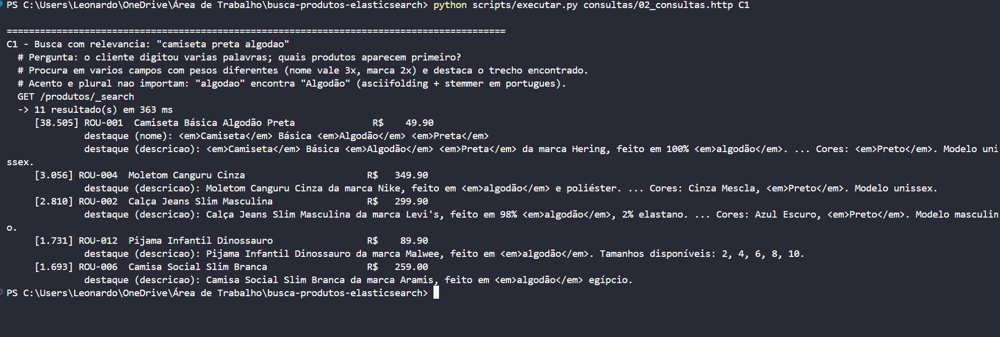

## C2 - [PONTO FORTE] Tolerancia a erro de digitacao: "samsumg galxy"

Pergunta: o cliente errou duas letras; mesmo assim encontramos o produto?
fuzziness AUTO aceita ate 2 letras trocadas/faltando/sobrando, conforme o tamanho da palavra.

```json
GET /produtos/_search
{
  "size": 5,
  "query": {
    "multi_match": {
      "query": "samsumg galxy",
      "fields": ["nome^3", "marca.texto^2", "descricao"],
      "fuzziness": "AUTO",
      "operator": "and"
    }
  },
  "_source": ["sku", "nome", "preco"]
}
```

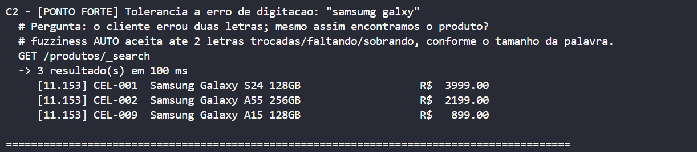

## C2b - [PONTO FORTE] Erro de digitacao no autor: "machdo de asis"


```json
GET /produtos/_search
{
  "size": 5,
  "query": {
    "match": {
      "atributos.autor": { "query": "machdo de asis", "fuzziness": "AUTO", "operator": "and" }
    }
  },
  "_source": ["sku", "nome", "atributos.autor", "preco"]
}
```

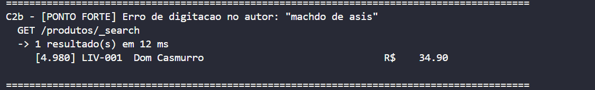

## C2c - [PONTO FORTE] Letras trocadas: "iphnoe"

Duas letras vizinhas trocadas contam como 1 edicao (fuzzy_transpositions e padrao).

```json
GET /produtos/_search
{
  "size": 5,
  "query": { "match": { "nome": { "query": "iphnoe", "fuzziness": "AUTO" } } },
  "_source": ["sku", "nome", "preco"]
}
```

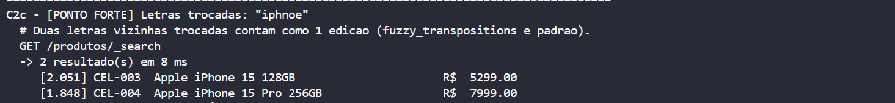

## C3 - Autocompletar: o cliente digitou "tenis cor" e ainda nao terminou

Pergunta: o que sugerir na caixa de busca enquanto a pessoa digita?
search_as_you_type + bool_prefix: a ultima palavra e tratada como prefixo ("cor" -> "Corrida").

```json
GET /produtos/_search
{
  "size": 5,
  "query": {
    "multi_match": {
      "query": "tenis cor",
      "type": "bool_prefix",
      "operator": "and",
      "fields": ["nome.autocompletar", "nome.autocompletar._2gram", "nome.autocompletar._3gram"]
    }
  },
  "_source": ["sku", "nome", "preco"]
}
```

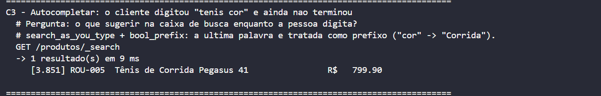

## C3b - Autocompletar: "harry pot"


```json
GET /produtos/_search
{
  "size": 5,
  "query": {
    "multi_match": {
      "query": "harry pot",
      "type": "bool_prefix",
      "operator": "and",
      "fields": ["nome.autocompletar", "nome.autocompletar._2gram", "nome.autocompletar._3gram"]
    }
  },
  "_source": ["sku", "nome", "preco"]
}
```

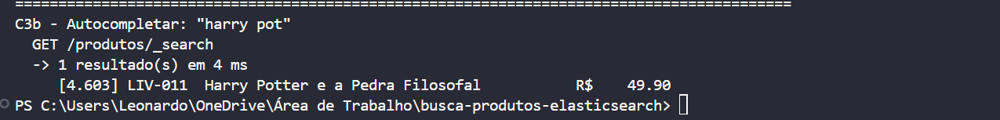

## C4 - Filtros e facetas: roupas tamanho M, ate R$ 400, com estoque

Pergunta: na pagina de Roupas, o cliente marcou "tamanho M", "ate R$ 400" e "disponivel".
As facetas (aggs) mostram as opcoes de TODA a categoria (marcas, faixas de preco, tamanhos)
e o post_filter aplica os filtros so na lista de produtos - igual ao menu lateral de uma loja.

```json
GET /produtos/_search
{
  "size": 10,
  "query": { "term": { "categoria": "roupa" } },
  "post_filter": {
    "bool": {
      "filter": [
        { "term":  { "atributos.tamanhos": "M" } },
        { "range": { "preco": { "lte": 400 } } },
        { "term":  { "emEstoque": true } }
      ]
    }
  },
  "aggs": {
    "marcas":       { "terms": { "field": "marca", "size": 20 } },
    "faixas_preco": { "range": { "field": "preco", "ranges": [ { "key": "ate 100", "to": 100 }, { "key": "100 a 300", "from": 100, "to": 300 }, { "key": "acima de 300", "from": 300 } ] } },
    "tamanhos":     { "terms": { "field": "atributos.tamanhos", "size": 30 } }
  },
  "sort": [ { "preco": "asc" } ],
  "_source": ["sku", "nome", "preco"]
}
```

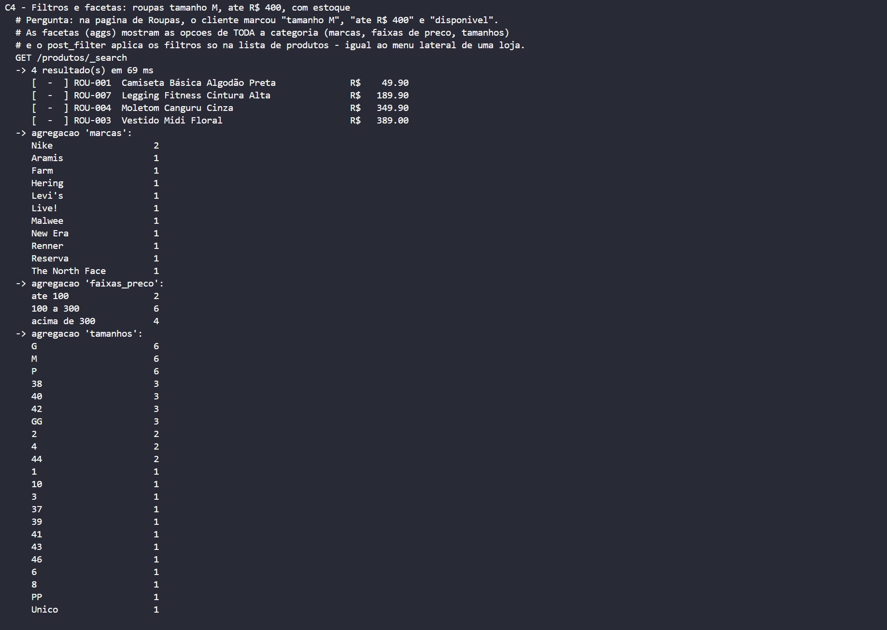

## C5 - Sinonimos + filtro: "telefone 5G" ate R$ 2.000

Pergunta: o cliente usou uma palavra que nao esta no cadastro ("telefone").
O filtro de sinonimos troca por celular/smartphone na hora da busca.

```json
GET /produtos/_search
{
  "query": {
    "bool": {
      "must":   { "multi_match": { "query": "telefone 5G", "fields": ["nome^3", "descricao"], "operator": "and" } },
      "filter": [ { "range": { "preco": { "lte": 2000 } } } ]
    }
  },
  "sort": [ { "preco": "asc" } ],
  "_source": ["sku", "nome", "preco"],
  "highlight": { "fields": { "descricao": {} } }
}
```

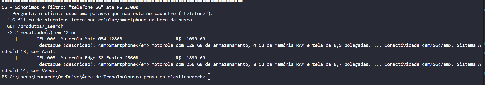

## C6 - Relevancia de negocio: "livro classico" priorizando bem avaliados e mais vendidos

Pergunta: entre os resultados que combinam com o texto, quais mostrar primeiro?
function_score multiplica a nota de texto por log(2 + nota media) e log(2 + vendas).

```json
GET /produtos/_search
{
  "size": 5,
  "query": {
    "function_score": {
      "query": { "multi_match": { "query": "livro classico", "fields": ["nome^3", "tags.texto^2", "descricao"] } },
      "functions": [
        { "field_value_factor": { "field": "notaMedia", "modifier": "ln2p", "missing": 0 } },
        { "field_value_factor": { "field": "vendas",    "modifier": "ln2p", "missing": 0 } }
      ],
      "score_mode": "multiply",
      "boost_mode": "multiply"
    }
  },
  "_source": ["sku", "nome", "preco", "notaMedia", "vendas"]
}
```

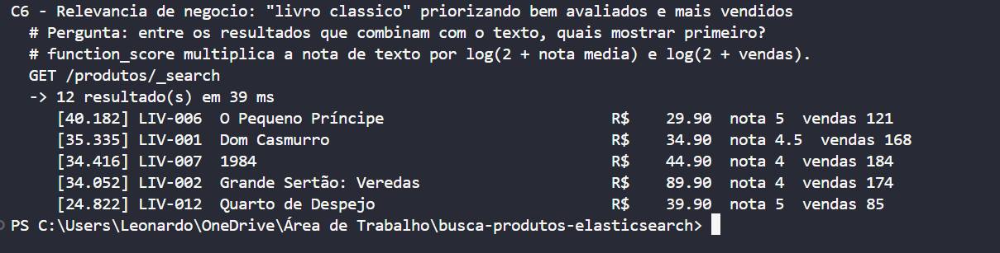

## C7 - "Voce quis dizer...?": sugestao de correcao para "camizeta algodao preeta"

Pergunta: a busca do cliente tem palavras erradas; qual a grafia correta para sugerir?

```json
GET /produtos/_search
{
  "size": 0,
  "suggest": {
    "correcao": {
      "text": "camizeta algodao preeta",
      "term": { "field": "nome.sugestao", "suggest_mode": "missing", "min_word_length": 3 }
    }
  }
}
```

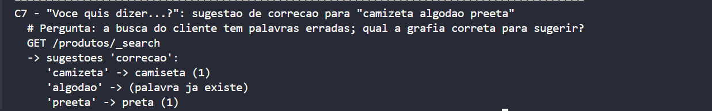

## C8 - Mais vendidos de cada categoria (ranking)

Pergunta: quais os 3 produtos mais vendidos em cada categoria, para a vitrine da home?

```json
GET /produtos/_search
{
  "size": 0,
  "aggs": {
    "por_categoria": {
      "terms": { "field": "categoria" },
      "aggs": {
        "top": { "top_hits": { "size": 3, "sort": [ { "vendas": "desc" } ], "_source": ["nome", "vendas"] } }
      }
    }
  }
}
```

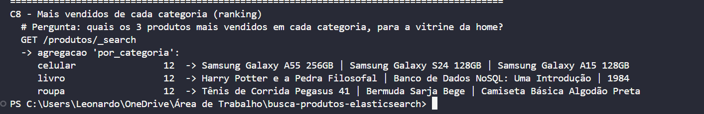
