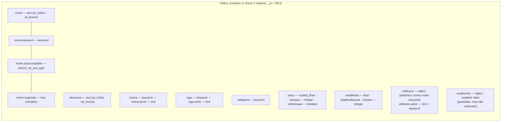
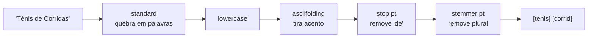

# Modelagem no Elasticsearch

## Ideia central

Em um banco de pesquisa a gente não modela "tabelas", modela **como cada campo vai ser encontrado**.
Todos os produtos ficam em um único índice, `produtos`, e cada produto é **um documento JSON completo**
(desnormalizado: marca, tags, atributos da categoria e resumo das avaliações vêm juntos).

Para cada campo decidimos:

- **`text`**: o texto é quebrado em palavras (tokens) e vai para o **índice invertido**. Serve para busca com relevância.
- **`keyword`**: o valor é guardado inteiro, sem quebrar. Serve para **filtro exato, facetas e ordenação**.
- Números, datas e booleanos: servem para **faixas** (`range`), ordenação e cálculo de relevância.

## Desenho do índice



### Analisadores (como o texto vira palavras pesquisáveis)



| Analisador | Filtros | Usado em |
|---|---|---|
| `pt_indice` | lowercase, asciifolding, stopwords pt, stemmer `light_portuguese` | ao **gravar** `nome`, `descricao`, `tags.texto` |
| `pt_busca` | os mesmos + **sinônimos** (`synonym_graph`) | ao **buscar** nesses campos |
| `simples` | lowercase, asciifolding | autocompletar, sugestão "você quis dizer", autor, marca |

Os sinônimos ficam só na busca: assim dá para mudar a lista sem reindexar os produtos.

### Exemplo de documento

```json
{
  "sku": "ROU-005",
  "nome": "Tênis de Corrida Pegasus 41",
  "descricao": "Tênis de Corrida Pegasus 41 da marca Nike, feito em mesh. Tamanhos disponíveis: 37, 38, ... Cores: Branco, Preto. Modelo unissex.",
  "categoria": "roupa",
  "marca": "Nike",
  "preco": 799.9,
  "estoque": 35,
  "emEstoque": true,
  "tags": ["esportivo", "calcado", "corrida"],
  "notaMedia": 4.75,
  "totalAvaliacoes": 4,
  "vendas": 220,
  "criadoEm": "2026-04-17",
  "atributos": { "tamanhos": ["37", "38", "39", "40", "41", "42", "43"], "cores": ["Branco", "Preto"], "material": "mesh", "genero": "unissex", "tipo": "calcado" },
  "avaliacoes": [ { "cliente": "Andre Luiz", "cidade": "Palmas", "nota": 5, "comentario": "Amortecimento excelente...", "data": "2026-08-16" } ]
}
```

Um celular tem `atributos.armazenamentoGB`, `atributos.cincoG`...; um livro tem `atributos.autor`, `atributos.isbn`...
Tudo no mesmo índice: o `dynamic_template` faz qualquer atributo de texto novo virar `keyword` automaticamente.

## Perguntas que o sistema responde e como a modelagem ajuda

| # | Pergunta | O que na modelagem resolve |
|---|---|---|
| C1 | O cliente digitou várias palavras: quais produtos aparecem primeiro? | `nome`, `descricao`, `tags.texto` como `text` com analisador em português; pesos por campo (`nome^3`); `highlight` |
| C2 | O cliente digitou errado ("samsumg galxy", "machdo de asis"): achamos mesmo assim? | Índice invertido + `fuzziness: AUTO` (distância de edição) sobre os mesmos campos `text` |
| C3 | O que sugerir enquanto a pessoa ainda está digitando ("tenis cor")? | Subcampo `nome.autocompletar` do tipo `search_as_you_type` (gera prefixos e pares de palavras na indexação) |
| C4 | Roupas tamanho M, até R$ 400, disponíveis — e quais marcas/faixas/tamanhos existem? | `categoria`, `marca`, `atributos.tamanhos` como `keyword` (filtro e faceta), `preco` numérico (`range`), `emEstoque` booleano; `aggs` + `post_filter` |
| C5 | O cliente usou uma palavra que não está no cadastro ("telefone")? | Filtro `synonym_graph` no analisador de busca `pt_busca` |
| C6 | Entre os que combinam com o texto, quais mostrar primeiro para vender mais? | `notaMedia` e `vendas` numéricos no próprio documento, usados no `function_score` |
| C7 | "Você quis dizer…?" para palavras escritas errado | Subcampo `nome.sugestao` (sem stemmer, para sugerir palavras reais) + `term suggester` |
| C8 | Quais os 3 mais vendidos de cada categoria? | `categoria` como `keyword` (agrupamento) + `vendas` para ordenar o `top_hits` |

### Decisões e o porquê

- **`_id` = SKU**: o mesmo produto nunca é duplicado na recarga e o CRUD acessa direto pelo código.
- **Desnormalizar marca, tags e resumo das avaliações**: busca não faz JOIN. Tudo que influencia a busca ou aparece no resultado precisa estar no documento.
- **`avaliacoes` com `enabled: false`**: o texto das avaliações volta na resposta (para a página do produto), mas não é indexado — ninguém busca produto pelo comentário de um cliente, e isso deixa o índice menor.
- **`marca` e `tags` com dois tipos** (`keyword` + `text`): o `keyword` dá faceta com o nome exato ("The North Face"); o `text` permite achar digitando "north face".
- **`preco` como `scaled_float`**: guarda centavos como inteiro internamente (mais compacto e sem erro de arredondamento nas faixas).
